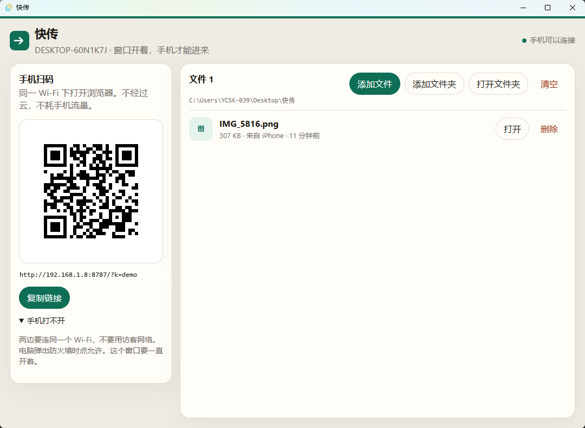

# 快传

同一 Wi-Fi 下，手机扫码和电脑互传文件。不经过云，不需要账号。

Send files between a phone and a computer over Wi-Fi. Scan the QR code. No cloud, no account.



电脑窗口显示二维码和文件列表。手机用浏览器打开后可以上传、预览和下载。文件保存在桌面的「快传」文件夹里。

手机和电脑要连同一个 Wi-Fi，不要用访客网络。窗口要一直开着。电脑弹出防火墙时点允许。

## 运行

双击 `启动.bat`，或在这个目录执行：

```
npm install
npm run tauri dev
```

第一次会编译 Rust，需要几分钟。
